<h1 align="center">Warehouse Delivery Robot</h1>

<p align="center"><b>Learning safe parcel delivery with Q-Learning and SARSA</b></p>

<p align="center">
  
  
  
  
  
</p>

<p align="center">
  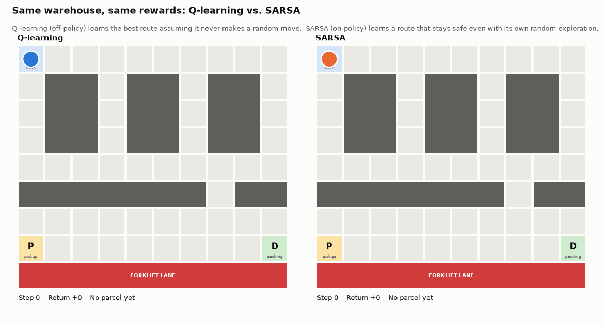
</p>

A delivery robot in a warehouse has to collect a parcel and take it to the packing station by the fastest route that stays out of the forklift lane. **Nobody gives it the map or the route.** It starts with an empty Q-table and learns from rewards alone. We train it with **tabular Q-learning**, compare it with **SARSA** and a **random agent**, and show every step of the learning with figures and live demos.

> **RL Innovation Hackathon** · Fundamentals of Reinforcement Learning · Assessment Task 2 · Problem domain: **Grid World**

## Results at a glance

| | Random agent | **Q-learning** | SARSA |
|---|:---:|:---:|:---:|
| Parcels delivered (test) | 0% | **100%** | 100% |
| Moves per delivery | n/a (188 per episode, mostly time-outs) | **30**, the shortest possible | 32 |
| Moves ending right beside the forklift lane | n/a | 12 of 30 | 0 of 32 |
| Collisions while still exploring (ε = 0.05) | n/a | 15.6% | 2.8% |
| Training episodes until the route is reliable | n/a | 270–340 | 260–410 |

Mean over **10 independent training runs** per algorithm; each test uses 100 episodes with exploration and learning switched off. Every run is seeded, so `python train.py` reproduces these numbers exactly (in about 3 seconds).

**Highlights**

- **Learns, not programmed.** The agent never sees the map; the breadth-first search in the code only draws the "best possible" line on the charts.
- **A real decision problem.** A barrier forces a detour *away* from the parcel, the task has two stages, and the fastest route runs beside a hazard.
- **Classic RL result, reproduced.** Q-learning (off-policy) takes the risky shortest route, while SARSA (on-policy) learns a safer one: Sutton & Barto's *cliff-walking* effect in a warehouse.
- **Robust under uncertainty.** On a slippery floor (10% of moves slide sideways) *both* agents switch to the safe route and still deliver in about 99% of tests.

## Demo

| The same robot, untrained → trained | A brand-new robot learning live |
|:---:|:---:|
| 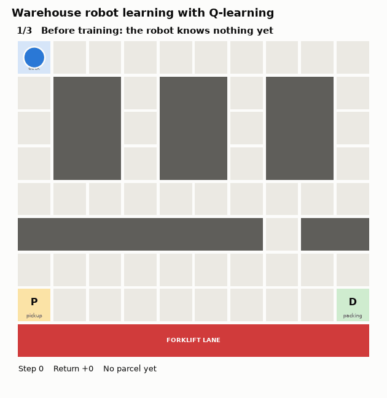 | 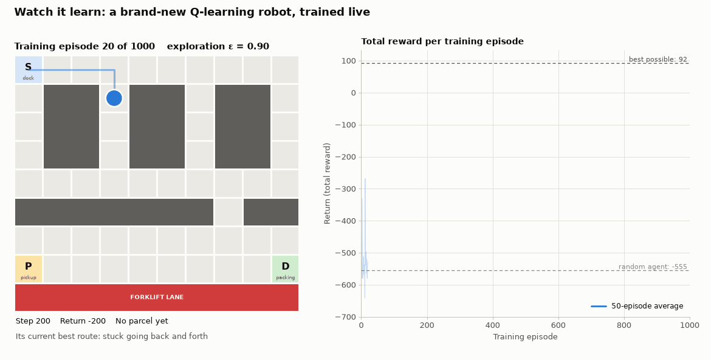 |

```bash
python demo.py               # the story above: untrained → part-way → fully trained
python demo.py --compare     # Q-learning vs. SARSA side by side (top of this page)
python demo.py --live        # train a brand-new robot on screen (about 20 s)
python demo.py --ascii       # the story in the terminal, no window needed
python demo.py --save x.gif  # save any demo as a GIF instead of opening a window
```

## Quick start

Requires Python 3.9 or newer.

```bash
git clone https://github.com/KS-KARTHIK-05/Warehouse-Delivery-Robot-using-Q-Learning-and-SARSA.git
cd Warehouse-Delivery-Robot-using-Q-Learning-and-SARSA

python3 -m venv .venv
source .venv/bin/activate          # Windows: .venv\Scripts\activate
pip install -r requirements.txt

python train.py                    # train + test both agents (10 runs each), write results/ and models/
python demo.py                     # animated demo
python train.py --slip 0.1         # slippery-floor experiment → results/slip_0.10/
```

If no demo window opens, matplotlib has no GUI toolkit: on Ubuntu run `sudo apt install python3-tk` once (the python.org installers for Windows and macOS already include it). Until then `demo.py` saves a GIF and opens it in your browser, and `--ascii` always works. Press `f` in a demo window for full screen and `q` to close it.

## The problem

```
S . . . . . . . . .      S  charging dock (start)
. # # . # # . # # .      P  pickup point: collect the parcel here
. # # . # # . # # .      D  packing station: deliver the parcel here
. # # . # # . # # .      #  storage rack or safety barrier (cannot be entered)
. . . . . . . . . .      ~  forklift lane (entering it is a collision)
# # # # # # # . # #      .  open floor
. . . . . . . . . .
P . . . . . . . . D
~ ~ ~ ~ ~ ~ ~ ~ ~ ~
```

The layout is built so that the robot has to make real decisions:

1. **A forced detour.** The parcel is straight below the dock, but the barrier's only gate is on the far right. A "move towards the goal" rule gets stuck against the barrier.
2. **Two stages.** Head for P first, then for D, so the same cell needs different moves at different times.
3. **Risk beside the shortest route.** The quickest way from P to D runs right next to the forklift lane; a route one row away is safer but 2 moves longer.

## MDP formulation

| Element | Definition |
|---|---|
| **Agent** | The robot's controller: a Q-learning or SARSA learner ([`agents.py`](agents.py)) |
| **Environment** | The 9 × 10 warehouse grid ([`warehouse_env.py`](warehouse_env.py)) |
| **State** $s$ | `(row, col, carrying)`: 53 floor cells × 2 = **106 states** |
| **Actions** $a$ | UP, DOWN, LEFT, RIGHT |
| **Transitions** | Deterministic one-cell moves; racks, the barrier and the outer wall block. Optional slippery floor (`--slip p`): with probability $p$ the robot slides sideways |
| **Discount** $\gamma$ | 0.99 |
| **Episode end** | Delivered (success), forklift-lane collision (failure), or 200 moves (time-out) |
| **Objective** | Maximise expected discounted return: deliver fast, never collide |

| Event | Reward | Why |
|---|:---:|---|
| Ordinary move | −1 | Time and battery cost, so shorter routes score higher |
| Bump into a rack or wall | −5 | Hitting shelves can damage goods |
| Pick up the parcel (first time at P) | +20 | Progress signal for stage one; collectable once |
| Deliver the parcel at D | +100 | The goal; ends the episode |
| Enter the forklift lane | −100 | Safety-critical failure; ends the episode |

The best possible run is 30 moves: $28 \times (-1) + 20 + 100 = \mathbf{92}$.

**Why the state includes `carrying`.** At the same cell the right move differs before and after the pickup. Without the flag the state would not be Markov: the best action would depend on history the state does not show.

**Time-outs are truncated, not terminated.** Running out of moves says nothing about the state itself, so the update still bootstraps from $Q(s', \cdot)$ at a time-out; only a delivery or a collision has zero future value.

## Algorithms

**Q-learning** (off-policy temporal-difference control), applied after every move:

$$Q(s,a) \leftarrow Q(s,a) + \alpha \Big[ r + \gamma \max_{a'} Q(s',a') - Q(s,a) \Big]$$

**SARSA** (on-policy), identical except that the target uses the action $a'$ the agent will really take next:

$$Q(s,a) \leftarrow Q(s,a) + \alpha \Big[ r + \gamma \, Q(s',a') - Q(s,a) \Big]$$

Actions are chosen **ε-greedily**: a random move with probability ε, otherwise the move with the highest Q-value.

**Why tabular Q-learning?**

- **Small and discrete:** 106 states × 4 actions = 424 values; a table is exact and fully inspectable. A neural network (DQN) adds nothing at this size.
- **Model-free:** the robot is never told the map, the transitions or the rewards; it learns only from interaction.
- **Off-policy:** it learns the value of the *best* route while still exploring.
- **Proven to converge:** tabular Q-learning reaches the optimal values given enough exploration (Watkins & Dayan, 1992).

**Why not just A\* or BFS?** A\* needs the map and costs up front, and our agent has neither. RL also maximises *expected* reward including risk: on the slippery floor the shortest route is no longer the best, and both agents learn that. Finally, the same code learns any layout: on a different warehouse it found the new 29-move optimum with no code changes.

| Hyperparameter | Value | Reason |
|---|---|---|
| Learning rate α | 0.1 | Learns the route in about 300 episodes; a decaying α needed up to 3× more episodes |
| Discount γ | 0.99 | A run takes about 30 moves: at γ = 0.95 the +100 delivery would be worth only 0.95²⁹ ≈ 0.23 of its value at the start, at 0.99 still ≈ 0.75 |
| Exploration ε | 1.0 → 0.05 | ×0.995 per episode, reaching 0.05 around episode 600 |
| Episodes | 1,000 (2,000 on the slippery floor) | The route is reliable after about 300 |
| Step limit | 200 | Ends endless wandering early in training |
| Independent runs | 10 seeds per algorithm | Mean ± std instead of one lucky run |

## Results

### Final test

| Agent | Delivery success | Moves per episode | Return per episode |
|---|:---:|:---:|:---:|
| Random agent | 0% | 188.3 ± 2.7 | −555.5 ± 5.9 |
| **Q-learning** | **100%** | **30.0 ± 0.0** | **92.0 ± 0.0** |
| SARSA | 100% | 32.0 ± 0.0 | 90.0 ± 0.0 |
| Best possible (BFS reference) | 100% | 30 | 92 |

The random agent never delivered in 1,000 test episodes; it timed out or drove into the forklift lane (17.8% of episodes).

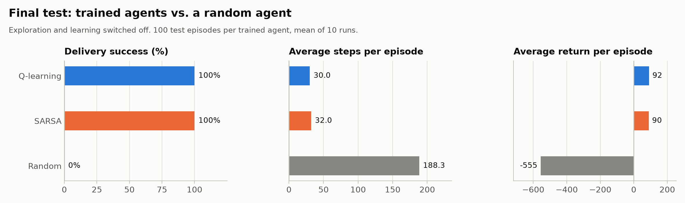

### Learning curves

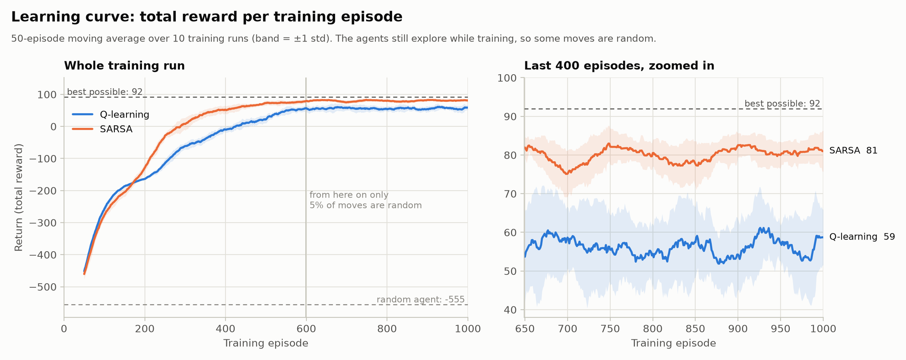

Both agents start at random-agent level and climb towards the best possible return. Over the last 100 training episodes SARSA earns more (80.5 vs. 57.9) because Q-learning's route runs beside the lane, where the remaining 5% of random moves sometimes cause a collision.

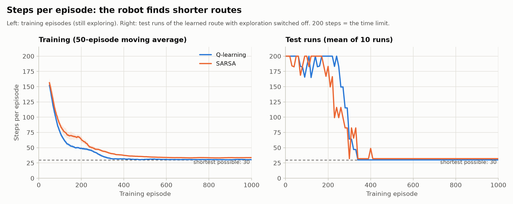

The learned route (right) shrinks from the 200-move limit to exactly 30 moves for Q-learning, the true optimum it was never told. SARSA settles at 32.

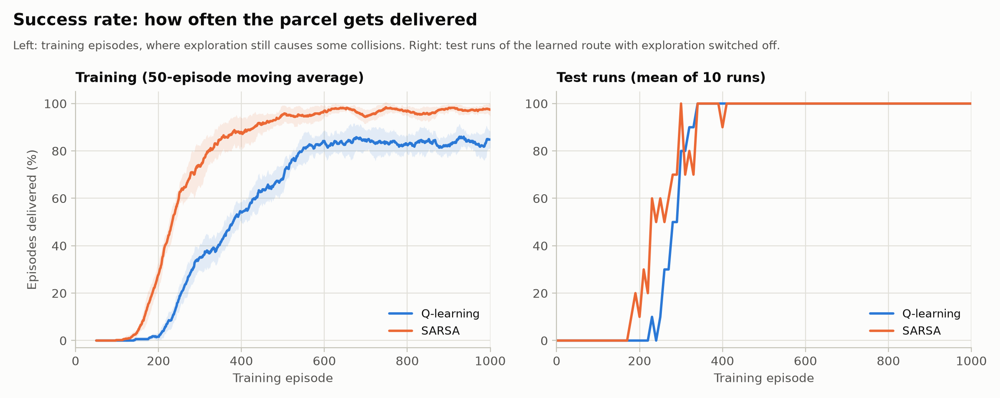

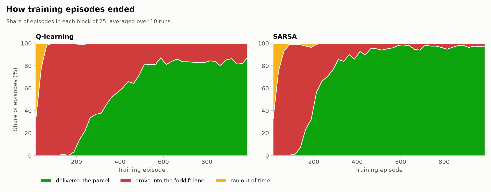

### What the agents learned

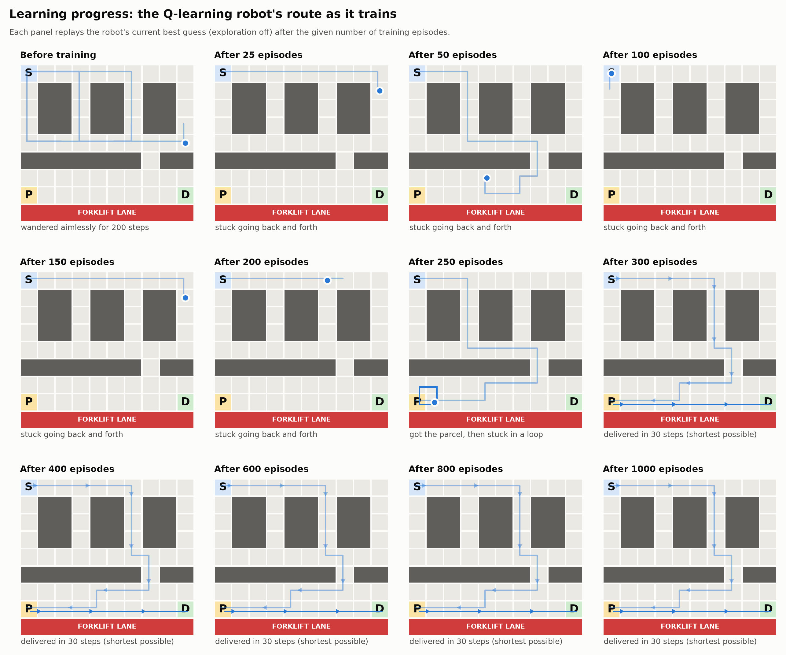

The same robot at twelve points in training. For about 200 episodes its best guess is to move back and forth on the same spot: the +100 delivery reward has not yet propagated back to the start through the Bellman updates. By episode 250 it fetches the parcel; from episode 300 on it takes the shortest route.

| Q-learning | SARSA |
|:---:|:---:|
| 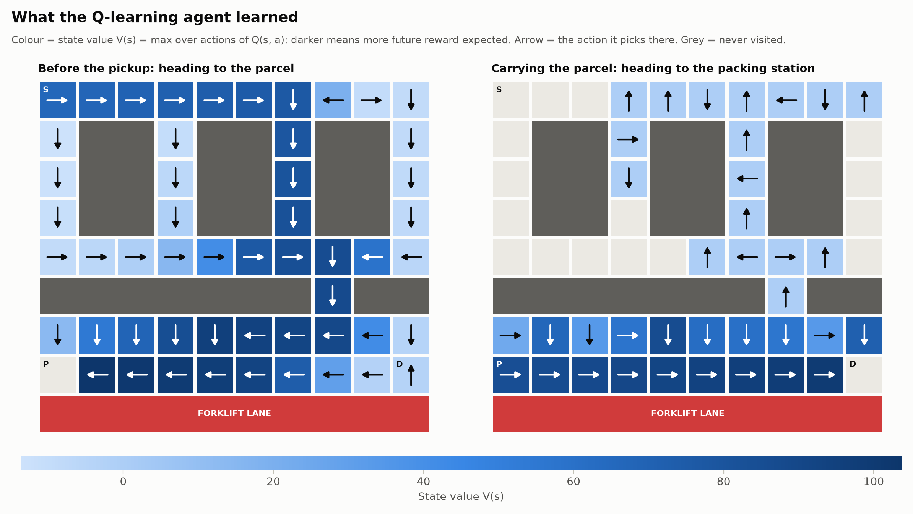 | 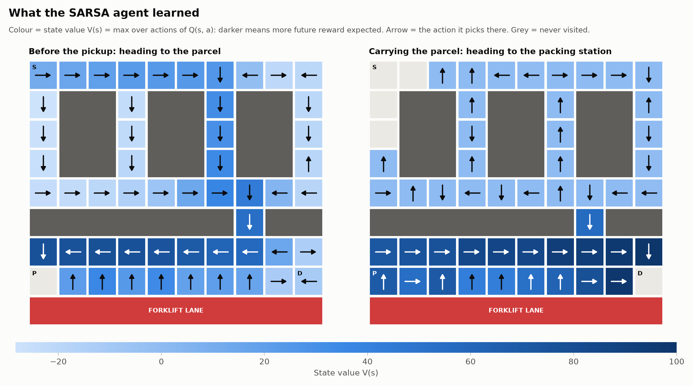 |

Colour is each state's expected future reward (darker is better); arrows are the chosen moves. While carrying the parcel on the row next to the lane, most of SARSA's arrows point *up*, away from the lane, and that row has lower values: it has priced in the risk of its own random moves.

**The cliff-walking effect.** Q-learning learns the optimal route assuming every move is executed perfectly; SARSA learns the best route given that it still explores. This reproduces Sutton & Barto's Example 6.6. If the robot executes its route exactly, Q-learning's route is optimal; if it keeps making occasional random moves (exploration, sensor noise), SARSA's caution pays off.

### Slippery floor (robustness)

`python train.py --slip 0.1` makes 10% of moves slide sideways. Over 10 runs × 2,000 episodes:

| Agent | Delivery success | Moves per episode | Return per episode |
|---|:---:|:---:|:---:|
| Random agent | 0% | 187.7 ± 4.1 | −553.9 ± 9.6 |
| Q-learning | 99.3 ± 0.8% | 36.8 ± 0.3 | 75.5 ± 1.7 |
| SARSA | 99.1 ± 1.2% | 36.9 ± 0.3 | 75.2 ± 2.0 |

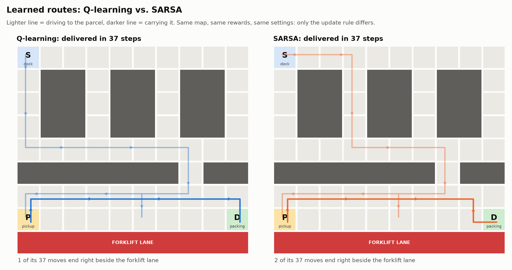

Now that a slip next to the lane is a real collision, **Q-learning also switches to the safer route**. RL optimises expected reward under uncertainty; a shortest-path planner would keep the risky route.

**Known limitation.** With a constant learning rate, Q-values keep fluctuating on a random floor, and now and then a run ends with a looping policy: 1 of 10 Q-learning runs at 1,000 episodes and 2 of 10 SARSA runs at 3,000 episodes, none at the default 2,000. Decaying α did not help: its worst slippery-floor runs reached only 82–92% success, against at least 94.5% with a constant α, and it slowed learning on the normal floor.

## How the code fits together

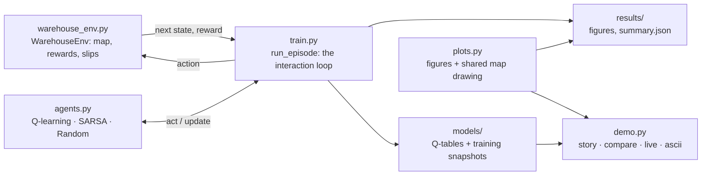

```
├── warehouse_env.py   environment: map, states, actions, rewards, slippery floor, BFS reference
├── agents.py          tabular Q-learning, SARSA (ε-greedy) and the random baseline
├── train.py           training loop, testing, experiments, saving results
├── plots.py           all figures, and the map drawing shared with the demo
├── demo.py            animated demos: story, --compare, --live, --ascii, --save
├── models/            learned Q-tables and snapshots taken during training
├── results/           figures, summary.json, training history, demo GIFs
└── docs/              full project report (PDF)
```

The full project report, with background theory, design, results and discussion, is in [`docs/`](docs/).

## Implemented vs. proposed

| Implemented and working | Proposed future enhancements |
|---|---|
| Warehouse grid world: racks, gated barrier, forklift lane, two-stage pickup → delivery task, step limit, optional slippery floor | **Deep Q-Network (DQN)** with experience replay and a target network, for warehouses too large for a table |
| Tabular Q-learning and SARSA with ε-greedy exploration and ε decay | **Prioritised experience replay** to learn faster from rare events such as collisions |
| Random-agent baseline, 10 seeded runs per algorithm, greedy test every 10 episodes, final 100-episode test | **Double Q-learning / Expected SARSA** and per-state learning rates for the slippery floor |
| 9 figures, `summary.json`, full training history, saved Q-tables and snapshots | **Moving forklifts**, several parcels per trip, battery level in the state |
| Demos: story, side-by-side comparison, live training, terminal mode, GIF export | **Multiple robots** (multi-agent RL); ROS/Gazebo simulation, then a physical robot |

<details>
<summary><b>Viva notes: likely questions and short answers</b></summary>

**What exactly does the agent learn?** One Q-value per state-action pair (106 reachable states × 4 actions). Q(s, a) estimates the total discounted reward of taking action *a* in state *s* and acting well afterwards. The policy picks the action with the highest Q-value.

**Where does the Bellman equation come in?** The target r + γ · max Q(s′, ·) is a one-step look-ahead from the Bellman optimality equation. The TD error is target minus estimate; each update moves Q(s, a) 10% (α) of the way.

**Why does ε decay, and why not to zero?** Early on exploring is valuable; later the agent should use what it learned. Keeping 5% lets it keep correcting estimates while training. Tests switch exploration off completely.

**Why is Q-learning's training success about 84% but its test success 100%?** In training 5% of moves are random and its route runs beside the lane, so a random DOWN move there is a collision. With exploration off that never happens.

**Why did the robot go back and forth early in training?** Reward information spreads backwards one step per update. Until the +100 at D reaches the start, nearby moves all look equally bad (each has only cost −1), so the greedy choice bounces between neighbouring cells.

**Is convergence guaranteed?** In theory yes: tabular Q-learning converges to Q\* with probability 1 if every state-action pair keeps being visited and the step size shrinks appropriately (Robbins–Monro; Watkins & Dayan, 1992). With constant α = 0.1, all 10 deterministic runs reached the exact optimum.

**Why the +20 pickup reward?** Without it the only positive reward would be 30 moves away, and random exploration would take far longer to find it. It can be collected once per episode, so it cannot be farmed.

**How is the comparison with SARSA fair?** Same environment, hyperparameters, seeds and number of runs; only the update target differs.

**What would change for a much larger warehouse?** The table grows with the number of states; beyond tens of thousands of states, or with continuous sensor input, a function approximator such as a DQN replaces it.

</details>

## Team

| Register number | Name | Section |
|---|---|---|
| RA2311026050027 | Karthik K S | A |
| RA2311026050057 | Arun Prasath | A |
| RA2311026050098 | Inzamam | A |

## References and acknowledgements

- R. S. Sutton and A. G. Barto, *Reinforcement Learning: An Introduction*, 2nd ed., MIT Press, 2018. Q-learning, SARSA and the cliff-walking example (Example 6.6).
- C. J. C. H. Watkins, *Learning from Delayed Rewards*, PhD thesis, University of Cambridge, 1989.
- C. J. C. H. Watkins and P. Dayan, "Q-learning", *Machine Learning* 8, 279–292, 1992.
- G. A. Rummery and M. Niranjan, "On-line Q-learning using connectionist systems", Technical Report CUED/F-INFENG/TR 166, Cambridge University Engineering Department, 1994.
- Libraries: NumPy and Matplotlib (with Pillow, installed alongside Matplotlib, for GIF export).
- AI assistance: this project was developed with help from Claude (Anthropic), an AI assistant.

## License

Released under the [MIT License](LICENSE).
